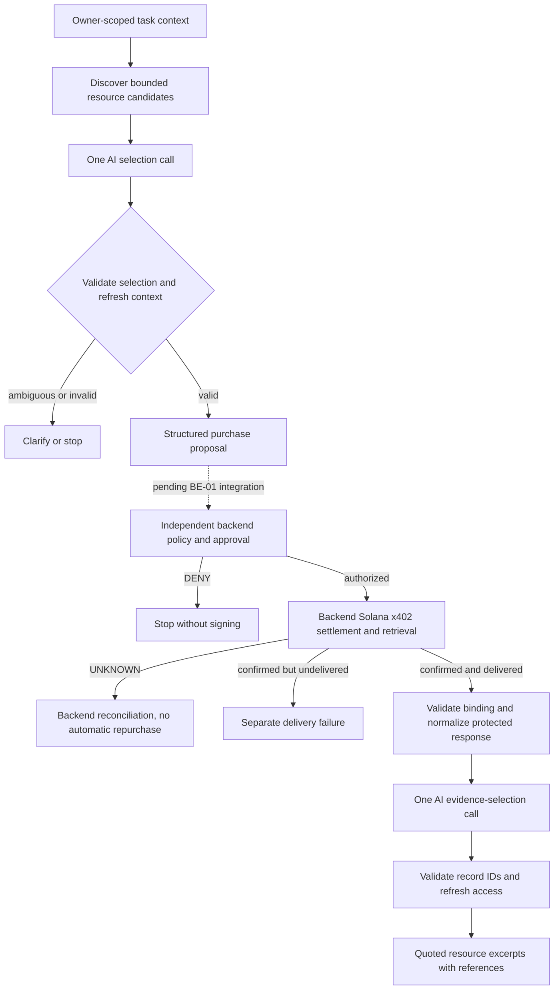

# AI-01: Single-agent purchasing workflow / 단일 에이전트 구매 흐름

Owner: Geondong Kim (`geondongkim`). Prepared: 2026-10-18 KST.

Updated 2026-10-21: [wallet analytics adapter and acceptance cases](AI_ANALYTICS_ADAPTER.md).

Status: **reference implementation tested locally; shared contract review pending**.
This document does not select an MVP, approve a backend API/schema, choose a model
provider, or claim a live purchase. AI-01 remains open until adjacent owners review
the interfaces. AI-02 and AI-03 have partial offline evidence only.

상태: 독립 참조 구현과 로컬 검증까지 진행했습니다. 공통 계약·최종 MVP·모델
공급자는 미정이며, 담당자 검토 전까지 AI-01/02/03 전체 완료로 표시하지 않습니다.

## Objective and sources / 목적과 근거

Prepare the shared AI work for all three MVP options while the team decides the
provider and shared interfaces. Match Michael's issue acceptance criteria and Ria's
separation of proposal, policy, payment, fulfillment and evidence.

- [AI-01 — workflow definition](https://github.com/web5five/Floww_Solana_Server/issues/2)
- [AI-02 — structured proposals](https://github.com/web5five/Floww_Solana_Server/issues/6)
- [AI-03 — resource consumption](https://github.com/web5five/Floww_Solana_Server/issues/7)
- [BE-01 — Ria's shared contracts](https://github.com/web5five/Floww_Solana_Server/issues/1)
- [SOL-01 — Taeheon's x402 validation](https://github.com/web5five/Floww_Solana_SmartContract/issues/1)
- [Michael's MVP Options Index](https://portfolio4ramp.atlassian.net/wiki/spaces/FTW/pages/4521985)
- [Ria's Data Specification](https://portfolio4ramp.atlassian.net/wiki/spaces/FTW/pages/3506508)
- [Team role plan](https://portfolio4ramp.atlassian.net/wiki/spaces/FTW/pages/3538962)

The GitHub issues were read on 2026-10-18 and last updated on 2026-10-16. The
Confluence pages were read on 2026-10-18 with an Oct 14 update label; a numeric
page revision was not captured. The role plan's multi-agent P0 entry and the
single-agent baseline in the issues need reconciliation. This implementation
follows the assigned single-agent baseline and leaves memory/multi-agent/Bayesian
experiments outside the baseline.

## Small common workflow / 공통 흐름



The reference implements B–F and L–O through injected local ports. G–K describe
backend-owned responsibilities and are represented by labeled fixtures only.
Two sequential model roles belong to one simple workflow; there are no autonomous
sub-agents, persistent memory, new services or new infrastructure.

For the bounded wallet report, `propose_analytics` also requires the explicit
wallet, data network and time window before discovery. The immutable proposal
retains that request. `consume_analytics` shares the confirmed-resource access
gate above, then validates and aggregates numeric records deterministically
instead of asking a model to calculate or invent the answer. Generic market and
translation adapters continue to use the original evidence-selection path.

참조 코드는 제안과 결과 소비를 구현합니다. 승인·서명·결제·조회 복구는 백엔드와
체인 담당 범위로 남겨둡니다. 순차적인 두 모델 호출 역할을 사용하며 실제 모델
공급자 연결은 별도입니다.

## Local tool boundaries / 로컬 도구 경계

These are **in-process reference ports**, not endpoint names or approved DTOs.
Python 3.11+ and its standard library are used only to make the behavior executable
without selecting the production server stack. The tests run without credentials,
network, package installation or a database.

| Step | Input and output | Owner / trust boundary |
| --- | --- | --- |
| Load/refresh context | Owner, task and mandate references/versions, minimum purpose text, validity | Backend adapter must authenticate and enforce ownership; the AI never chooses owner/task scope. |
| Discover candidates | Bounded catalog for that context; merchant/resource ID and exact observed requirement reference plus displayable quote fields | Backend/merchant adapter. Treat descriptions as data; no arbitrary model URL fetch. |
| Select candidate | System instruction + purpose + at most 20 candidates → PROPOSE, CLARIFY or STOP JSON | One model call. It can choose an existing candidate ID and give a short reason. |
| Construct proposal | Validated choice + immutable tool fields + fresh context → proposal | AI component. Financial fields are copied from the tool observation. No approval/sign/pay tool exists. |
| Submit proposal | Proposal reference and reviewed terms bound to the active task/mandate | **Pending Ria's interface.** No actual submission is implemented here. |
| Observe outcome | Matching proposal/context/requirements and attempt; policy, payment and delivery states; evidence references | **Trusted backend adapter only.** A model, browser or merchant cannot supply this object as authority. |
| Read protected response | Confirmed delivery reference → media type and exact body | Backend adapter checks current access and body-to-delivery integrity before supplying content. |
| Select evidence | Minimum purpose text + normalized records → 1–10 existing record IDs | One model call without execution tools. |
| Produce result | Exact selected record text and constructed source references | Deterministic excerpts. Semantic summary quality and actual model behavior remain unverified. |

Callback deadlines, cancellation, authenticated endpoint mappings, durable state
and idempotency belong to the production adapters. The reference catches reported
tool exceptions and never retries automatically, but it cannot interrupt a hung
callback. Its UUID identifies a local proposal; it is **not** a durable backend
idempotency key or an authorization token.

## Proposal fields / 제안 필드

| Local field | Meaning | Origin |
| --- | --- | --- |
| `proposal_ref` | Local correlation reference | Application, not model |
| `context` | Owner/task/mandate references, versions, purpose and validity | Authenticated backend context |
| `candidate.candidate_id` | One candidate from the current bounded catalog | Model selects from tool-provided IDs |
| `merchant_ref`, `resource_ref` | Provider and requested protected resource | Tool observation |
| `requirements_ref` | Reference to the exact observed payment requirement | Tool observation; protocol representation/hashing still needs review |
| `amount_atomic`, `asset_ref`, `network_ref`, `recipient_ref`, `valid_until` | Observed quote terms | Tool observation, copied without alteration |
| `explanation` | Bounded, untrusted short model rationale | Model; not policy or payment evidence |

The local amount check accepts a positive ASCII integer string of at most 78
digits. It is a defensive fixture convention, **not** a Solana integer-width,
asset-decimal or x402 protocol decision. Network/asset/recipient are opaque
references here. Taeheon and Ria must agree actual formats, payment alternatives,
exact requirement binding, expiry and any zero-price/free-resource path.

Example model response (synthetic catalog ID):

```json
{"action":"PROPOSE","candidate_id":"market_research","reason":"The supplied sample data fits the comparison request."}
```

Additional fields such as `policy`, `amount_atomic`, `signature` or
`execute_payment` are rejected. Unknown candidates, duplicate JSON keys, invalid
Unicode, unsupported shapes and oversized outputs stop the flow. After selection,
the component reloads the context and checks expiry before returning a proposal.
The backend still must revalidate the **current exact** payment requirement and
approval immediately before signing; an earlier AI snapshot is insufficient.

## Outcome handling / 결과·실패 처리

Trusted backend `reason_code` and `next_action` tokens are retained separately
from the AI component's own result code. They are not executable commands. The
reference accepts optional uppercase diagnostic tokens; BE-01 will map the
agreed wire fields/enums to these local values.

| Observation | AI behavior | Required external responsibility |
| --- | --- | --- |
| No candidate or ambiguous purpose | Ask one focused clarification; no proposal | User clarification and refreshed task |
| Tool/model timeout or malformed output | Stop with a fixed reason code; no raw exception in result | Adapter deadlines/observability, user-controlled retry policy |
| Owner/task/mandate/purpose changed during selection | Discard stale proposal | Reload authorized context |
| Policy DENY | Return DENIED; do not read content or call result model | Backend guarantees no new signing/broadcast |
| Authorization/payment pending | Return WAITING | Backend-owned progress observation |
| Payment UNKNOWN | Return reconciliation-required; do not initiate another purchase | Reconcile original attempt before any new authorization |
| Payment failed | Stop; no success or automatic repayment | Backend recovery procedure |
| Payment confirmed, fulfillment pending/failed | Show distinct resource pending/undelivered reason | Retrieve/reconcile delivery for existing payment; no silent repayment |
| Confirmed + delivered but body missing/invalid | Stop result generation; preserve payment separately | Backend delivery investigation |
| Wrong proposal/context/requirement/delivery reference | Stop | Trusted adapter binding verification |
| Invented record ID or model-authored success claim | Reject result output | Valid source-bound evidence selection |
| Context/access changes during result inference | Withhold result | Authenticated backend read policy |

`BackendOutcome` is a trusted adapter input, not a cryptographic verifier. A string
named `backend_verified` proves nothing by itself. Settlement and delivery
references must be verified by their owners. AI result status must never overwrite
the backend's independent payment/fulfillment history.

An expired spending mandate does not by itself delete access to previously
purchased content. The reference checks current scoped context before reading and
before release, and leaves the actual retention/read-access policy to Ria. The
backend must still check the request's access when returning the result, since a
local comparison cannot provide an atomic cross-process authorization guarantee.

## Swappable resources and evidence / 교체 가능한 리소스와 근거

- Market research: synthetic JSON product records.
- Translation: synthetic plain-text translation.
- Solana analytics: synthetic JSON report records; no RPC results are claimed.

`normalize_resource` accepts a small JSON `{id, text}` record list or plain text.
It refuses HTML, duplicate IDs, missing content and oversized bodies. The real
provider's schema will require a reviewed adapter; the fixture schema does not
choose the merchant or impose its response format.

The result model selects IDs only. The component then returns the exact resource
text and a delivery-local source reference. This demonstrates grounded extraction,
not factual truth of the provider, semantic entailment, a polished synthesis, or
translation quality. All excerpts remain untrusted text: a future renderer must
escape them, and another agent must not execute their embedded instructions.

## Acceptance mapping / 인수 조건과 현재 증거

| Issue criterion | Current evidence | Remaining gate |
| --- | --- | --- |
| AI-01 common tool flow | Diagram, ports and failure table above | Team interface review |
| AI-01 proposal fields | Reference fields and strict selector | Ria/Taeheon shared contract approval |
| AI-01 safe failure behavior | Proposal and consumption regression tests | Real backend binding and recovery tests |
| AI-01 swappable adapters | Three synthetic examples | Chosen provider format |
| AI-01 align adjacent owners | [Review questions](AI-01_REVIEW_AND_HANDOFF.md) prepared | No owner approval claimed |
| AI-02 structured proposals | Exact tool fields, bounded model selection, no execution capability | Approved backend submission interface + actual model |
| AI-02 ambiguity/tool errors | Clarification, stop and redacted failure tests | Model-provider error mapping/deadlines |
| AI-03 protected-resource consumption | Confirmation and binding gate; exact excerpts/citations | Actual authenticated protected response + settlement |
| AI-03 safe failure behavior | No result-model call on DENY/UNKNOWN/undelivered | Actual integrated scenario evidence |
| AI-03 baseline/fixtures | Single workflow, three explicitly synthetic cases | Selected demo integration/product acceptance |

Do not close any of the three issues from this partial reference change.

## Reproduce / 재현

From the repository root:

```sh
PYTHONPATH=reference python3 -m unittest discover -s reference/tests -v
PYTHONPATH=reference python3 -m ai_baseline.demo
git diff --check
```

Windows PowerShell:

```powershell
$env:PYTHONPATH = "reference"
python -m unittest discover -s reference/tests -v
python -m ai_baseline.demo
git diff --check
```

These commands only demonstrate local behavior. Windows execution, live model
calls, real HTTP 402 negotiation, Devnet payment, merchant verification, deployment
and frontend E2E are not verified by the reference suite.
